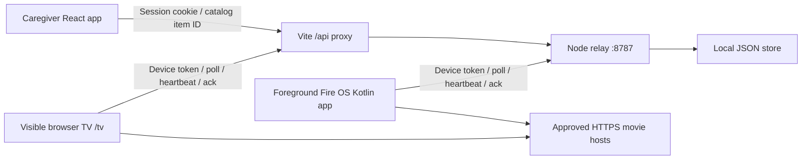
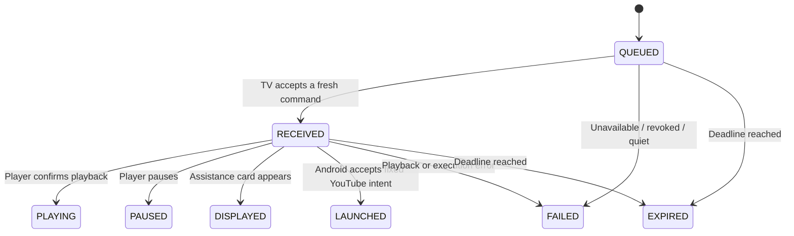

# Architecture

MomPilot’s local transport is foreground HTTP polling. A native Fire OS app and a browser TV demo share a relay contract with the caregiver web app.

There is no incoming connection to the television. A caregiver command is a request to the relay; the TV next polls the relay, acknowledges receipt, executes the allowed action, then reports a result. Media streams directly from its catalog host to the player.

## Pairing and identities

The TV registers for a device credential and a six-digit code. Codes expire after five minutes and are single-use. The caregiver creates a name-only demo session with an HTTP-only cookie, then submits the code. The relay associates that session with the device. An unpaired TV can refresh its code. Revoking on the TV removes caregiver access, fails pending commands, and generates a new code.

This proves the pairing mechanics, not the PRD’s invited-caregiver identity requirement. Anyone who can reach this local demo can create a named session. The name is not verified, and it does not recover an account. Production requires real identity, invitations, durable membership, and secure credential lifecycle handling.

## Command lifecycle

The caregiver submits a device ID, a supported command type, an idempotency key, and a catalog item or message preset ID when required. The relay validates device ownership, presence, quiet mode, and payload. A retry with the same key and payload returns the original command; changing the payload under that key fails.

The deadline is 30 seconds. TVs must reject stale IDs even if a request or response arrives late. The relay redelivers unfinished commands; client deduplication prevents an observed ID from starting a second playback. This is bounded retry behavior, not an exactly-once guarantee across arbitrary client crashes. Subsequent player activity is reflected in heartbeats; the command result records that command’s effect.

`PLAYING` must follow an actual player signal. Receiving the command, loading an item, or asking a browser to play is not sufficient. A browser autoplay rejection becomes an explained failure with a local Play action.

The optional `OPEN_YOUTUBE` command accepts only `itemId: "bunny"`. The native client maps that ID to the fixed video `aqz-KE-bpKQ` and explicit Android TV package `com.google.android.youtube.tv`; the caregiver cannot choose a URL, video ID, or package. The Big Buck Bunny preview exposes this experiment. The browser receiver rejects it as unsupported.

Its terminal result is `LAUNCHED`, meaning Android accepted the `ACTION_VIEW` intent, not that the requested video is playing. A successful launch acknowledgment includes `foreground:false`; the relay atomically stores the result, marks MomPilot unavailable, pauses its own playback metadata, and fails other pending commands. Repeated acknowledgments are idempotent and cannot take a resumed device offline again. Reopening MomPilot restores presence through a fresh heartbeat. An expired or lost launch acknowledgment is unconfirmed because the external app may already have opened; the native journal prevents automatic relaunch.

## Presence and parent control

The native TV client polls only while active; the browser demo uses its **Simulate app closed** control to model that boundary. Merely putting the browser tab behind another tab is not a hardware lifecycle test. Clients send heartbeats approximately every five seconds. The relay marks a device online only if it reports foreground and its latest heartbeat is less than 15 seconds old. Closing a page, losing power, or losing the network can therefore leave a short stale interval. Presence does not describe the physical television’s power or the status of Netflix, YouTube, or another player.

Quiet mode blocks new caregiver commands and fails pending ones. This version has a manual quiet toggle; a clock-based quiet window is planned. The parent can dismiss help, use the local player, return home, and revoke access. A help card never indicates that the caregiver can see the TV screen.

## Storage and trust boundaries

The relay stores local demo state in `.local/relay.json`, replacing the file atomically. Credential hashes are persisted on the relay. Browsers persist the TV credential locally; the native client uses app-private storage. Treat the entire local data directory as private and keep it out of source control. Restarting the relay preserves local state; deleting its data requires pairing clients again.

The relay accepts catalog IDs and preset IDs, never arbitrary video URLs, packages, shell commands, or remote-control key injection. It enforces body limits and demo rate limits. These controls do not make it suitable for public hosting: there is no deployed TLS endpoint, verified authentication, distributed rate limit store, security review, backup policy, or production monitoring.

The HTTP localhost origin and development server are for development. Native LAN tests require an explicit network binding and reachable server address; restrict them to a trusted network. See [AWS migration](AWS.md) before any public deployment.

## Platform boundary

The Android project targets Fire OS, not Vega OS; its limited YouTube intent experiment currently targets only the Android TV package and makes no Fire OS YouTube compatibility claim. The Gradle 8.11.1 wrapper build and lint passed, but native runtime validation remains outstanding. See [APK details](../android/README.md) and [recorded verification](VERIFICATION.md).

The browser route is a useful test client, not a Fire TV emulator. Background delivery, reboot recovery, sleep behavior, remote focus navigation, codecs, and device-specific media behavior require [the physical device spike](DEVICE-SPIKE.md). The experiment cannot inspect or control YouTube playback and does not extend MomPilot’s foreground-only boundary. AWS deployment, different-network delivery, and physical Fire OS operation remain unverified.
