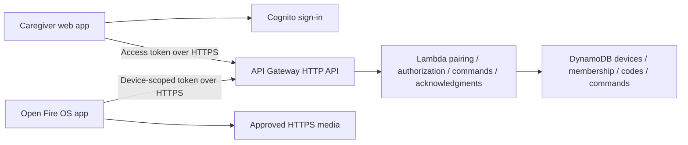

# AWS migration plan — not implemented

There are no deployed AWS resources, AWS infrastructure templates, or runtime AWS integrations in this prototype. The current relay is a local Node process with JSON persistence. This document is a proposed path from that contract to an authenticated service reachable from different networks. It is not evidence of AWS challenge eligibility.

## First cloud version

Keep foreground polling for the first deployed version. It matches the native source’s lifecycle and makes the product requirement explicit: the parent opens MomPilot before remote help starts. A persistent socket is a later transport experiment, not a prerequisite for the core demo.

| Component | Proposed responsibility | Migration from the prototype |
| --- | --- | --- |
| Cognito | Verified caregiver sign-in and recoverable identity | Replace name-only sessions; introduce invitations and membership. |
| API Gateway HTTP API | Public HTTPS routes and caregiver JWT validation | Preserve API response shapes where practical; configure strict origins and access-token scopes. |
| Lambda | Ownership checks, pairing, allowlist validation, command expiry, acknowledgments | Extract relay domain logic from the Node HTTP server; avoid in-memory state assumptions. |
| DynamoDB | Durable device, membership, pairing-code, command, and idempotency records | Replace the local JSON store with conditional writes and access-pattern-specific indexes. |
| Device authorization | Device-scoped credential validation and revocation | Replace long-lived local demo credentials with an explicitly designed provisioning, expiry, rotation, and recovery flow. |

API Gateway supports JWT authorizers using Cognito as an identity provider. Require the intended issuer, audience, and access-token scopes; a valid identity token alone is not a device-membership check. Keep authorization in the application too. [AWS JWT authorizer documentation](https://docs.aws.amazon.com/apigateway/latest/developerguide/http-api-jwt-authorizer.html)

## State and concurrency design

Suggested records are `Device`, `Membership`, `PairingCode`, `Command`, and `IdempotencyKey`. Do not treat this list as a deployed schema. Define exact keys, indexes, retention periods, and transaction boundaries before implementation.

- Consume an unexpired pairing code and assign membership atomically. Two concurrent claims must produce one winner.
- Store an idempotency key with a canonical payload hash. An identical retry returns the original command; a conflicting payload fails.
- Update command state conditionally from its expected previous state and reject mismatched device ownership.
- Check expiry in application code on creation, polling, and acknowledgment. DynamoDB TTL is delayed cleanup, not a deadline enforcement mechanism.
- Store heartbeat timestamps separately from command success. An online device can still fail to load media.
- Make revocation immediately authoritative. Invalidate membership and device authorization generations; reject commands created under an older authorization generation.

[DynamoDB conditional expressions](https://docs.aws.amazon.com/amazondynamodb/latest/developerguide/Expressions.ConditionExpressions.html) support writes with preconditions. [DynamoDB TTL](https://docs.aws.amazon.com/amazondynamodb/latest/developerguide/TTL.html) may delete expired records days later, so a still-present item must not be assumed valid.

## Credential and privacy work

Never put AWS access keys, a Cognito client secret, or a shared fleet secret in the APK. A TV credential must authorize only its own registration, poll, acknowledgment, heartbeat, settings, and revocation operations. Provision it through a reviewed pairing flow and store it with platform-appropriate protection. Specify how theft, app reset, device replacement, rotation, and lost caregiver access are handled.

Use HTTPS throughout, production cookie/token protections, restrictive CORS, distributed abuse limits, and short server-side authorization caches. Rate-limit code guessing across IP, device, and account dimensions. Log command IDs and failure categories; redact tokens, pairing codes, and unnecessary personal data. Set explicit retention for pairing attempts, heartbeat data, and viewing metadata. Add monitoring and billing alarms before public traffic.

These are release prerequisites for this product, not controls already provided by the local demo.

## Validation gate

1. Deploy to a test environment with real caregiver sign-in and device authorization.
2. Run the existing contract tests against an isolated cloud fixture and add concurrent pairing/idempotency tests.
3. Pair a physical Fire OS device, keep MomPilot open, and send ten commands from a phone on a separate network.
4. Record receipt latency and actual player results. Exercise dropped responses, duplicate requests, expired commands, quiet mode, network loss, and revocation.
5. Capture evidence of API Gateway, Lambda, and DynamoDB activity with sensitive values redacted.
6. Decide whether foreground polling meets the latency/cost target before evaluating API Gateway WebSocket or AWS IoT Core transport.

A WebSocket or MQTT connection would still need to reconnect, reauthorize, deduplicate, and respect the app lifecycle. Do not claim wake-up or background operation from a successful foreground test.
