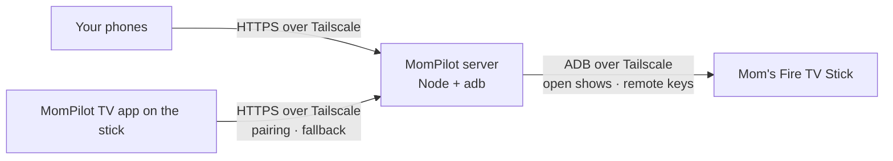

# Setting up MomPilot for real

Three things need to be set up once: the **server** (your PC or a free VM), **Mom's Fire TV Stick**, and **your phones**. Tailscale connects them; nothing is exposed to the public internet.



## 1. Tailscale account

1. Sign up at https://tailscale.com (the free Personal plan is enough).
2. In the admin console → **DNS**: turn on **MagicDNS** and **HTTPS Certificates**. This gives the server a real HTTPS address like `https://my-pc.tail1234.ts.net`.

## 2. The server

The server needs to be on whenever Mom might call. Pick one:

### Option A: your Windows PC

1. Install [Node.js 22 LTS](https://nodejs.org), [Git](https://git-scm.com), [Tailscale](https://tailscale.com/download) (sign in), and [Android SDK Platform-Tools](https://developer.android.com/tools/releases/platform-tools). If platform-tools isn't in the standard Android SDK folder, add it to PATH.
2. Get the code and build it:
   ```powershell
   git clone https://github.com/lazydevpro/mom-pilot.git
   cd mom-pilot
   npm ci
   npm run build
   ```
3. Start it once to check: `npm start`. It prints `MomPilot server: http://127.0.0.1:8787 (adb: …)`. Stop it with Ctrl+C.
4. Publish it on your tailnet over HTTPS (runs in the background and survives restarts):
   ```powershell
   tailscale serve --bg 8787
   ```
   It prints your address, for example `https://my-pc.tail1234.ts.net`. That's the **server address** used below.
5. Start MomPilot automatically when you sign in to Windows (PowerShell, from the `mom-pilot` folder):
   ```powershell
   $action = New-ScheduledTaskAction -Execute (Get-Command node).Source -Argument 'server\index.mjs' -WorkingDirectory (Get-Location).Path
   $settings = New-ScheduledTaskSettingsSet -RestartCount 999 -RestartInterval (New-TimeSpan -Minutes 1) -ExecutionTimeLimit 0 -AllowStartIfOnBatteries -DontStopIfGoingOnBatteries
   Register-ScheduledTask -TaskName MomPilot -Action $action -Trigger (New-ScheduledTaskTrigger -AtLogOn) -Settings $settings
   Start-ScheduledTask -TaskName MomPilot
   ```
   In Windows power settings, stop the PC from sleeping while plugged in.

### Option B: a free Google Cloud e2-micro VM (always on)

1. Create an **e2-micro** VM in us-west1, us-central1 or us-east1 with a **standard** persistent disk, Debian 12. Don't open any firewall ports.
2. On the VM:
   ```bash
   curl -fsSL https://tailscale.com/install.sh | sh && sudo tailscale up
   sudo apt-get update && sudo apt-get install -y adb git
   curl -fsSL https://deb.nodesource.com/setup_22.x | sudo bash - && sudo apt-get install -y nodejs
   sudo useradd --system --create-home mompilot
   sudo -u mompilot git clone https://github.com/lazydevpro/mom-pilot.git /home/mompilot/mom-pilot
   cd /home/mompilot/mom-pilot && sudo -u mompilot npm ci && sudo -u mompilot npm run build
   ```
   The repository is private: clone with a GitHub token, or copy the folder over.
3. Create `/etc/systemd/system/mompilot.service`:
   ```ini
   [Unit]
   Description=MomPilot
   After=network-online.target tailscaled.service
   Wants=network-online.target

   [Service]
   User=mompilot
   WorkingDirectory=/home/mompilot/mom-pilot
   ExecStart=/usr/bin/node server/index.mjs
   Restart=always
   RestartSec=5

   [Install]
   WantedBy=multi-user.target
   ```
4. Start it, then publish it over HTTPS:
   ```bash
   sudo systemctl enable --now mompilot
   sudo tailscale serve --bg 8787
   ```

### Keep these safe

- `.local/relay.json` holds your account, shows and pairing. Back it up now and then.
- The ADB key in the server user's home folder (`~/.android/adbkey`, on Windows `%USERPROFILE%\.android\adbkey`). Mom's TV trusts this key. If you move the server to another machine without it, Mom has to press **Allow** on the TV again.

## 3. Mom's Fire TV Stick

Needs a **Fire OS** stick (Settings → My Fire TV → About shows Fire OS 7 or 8). Vega OS sticks don't allow this.

1. **ADB debugging:** Settings → My Fire TV → About → select the device name 7 times. Back → **Developer Options** → **ADB debugging** on.
2. **Tailscale:** install it from the Amazon Appstore if it's listed; otherwise follow https://tailscale.com/kb/1394/install-amazon-fire. Sign in by scanning the QR code with your phone. Note the stick's address (`100.x.y.z`).
3. **Keep Tailscale on after a restart:** from the server:
   ```bash
   adb connect 100.x.y.z:5555
   adb -s 100.x.y.z:5555 shell settings put secure always_on_vpn_app com.tailscale.ipn
   ```
   The first `adb connect` shows **"Allow USB debugging?"** on the TV: tick **Always allow from this computer** and press **Allow**.
4. **MomPilot TV app:** install the APK and open it once:
   ```bash
   adb -s 100.x.y.z:5555 install -r android/app/build/outputs/apk/release/app-release.apk
   adb -s 100.x.y.z:5555 shell am start -n com.mompilot.tv/.MainActivity
   ```
   On the TV, enter the **server address** from step 2 (for example `https://my-pc.tail1234.ts.net`). A six-digit code appears.
   - On **Fire OS 8** only, also run `adb -s 100.x.y.z:5555 shell appops set com.mompilot.tv SYSTEM_ALERT_WINDOW allow` so the app can open shows from the background.

## 4. Your phones

1. Install Tailscale and sign in to the same account. Leave it on.
2. Open the **server address** in Chrome (Android) or Safari (iPhone). Enter your name.
3. **TV** tab → enter the code shown on the TV. Then enter the stick's address as `100.x.y.z:5555` under **Address for the remote** and save. The status at the top turns green.
4. Add it to the home screen: Safari → Share → **Add to Home Screen**; Chrome → menu → **Add to Home screen / Install app**. On iPhone, the home-screen app has its own storage: open it, choose **Already use MomPilot on another phone?**, and enter a code from **TV → Your phones → Add another phone** in Safari.
5. Your second phone: same steps 1–2, then use **Already use MomPilot on another phone?** with a code from the first.

On Android, once installed, you can share a link from the YouTube, Netflix or Prime Video app straight to **MomPilot**.

Then go through [CHECKLIST.md](CHECKLIST.md).
