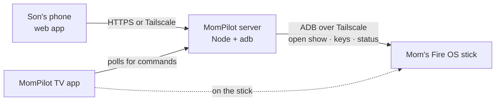

# MomPilot — research and build plan

9 October 2026 · Goes with [PRD.md](PRD.md) · Deadline 23 October 2026, 12:00 PM PT (24 October, 12:30 AM IST)

**Status, 14 October:** server, phone app and TV app are built (35 automated tests; signed release APK). Not yet run against a real Fire TV. Next: set up with [DEPLOY.md](DEPLOY.md) and work through [CHECKLIST.md](CHECKLIST.md). HTTPS now comes from `tailscale serve`.

## 1. Recommendation in one paragraph

Use **ADB over Tailscale** from a small always-on MomPilot server to drive Mom's Fire OS stick. ADB can open a specific show in YouTube, Netflix or Prime Video and press any remote key, from any network. Keep a small **MomPilot TV app** on the stick: it is the Fire TV app the hackathon needs, handles pairing, and can open shows itself if ADB is ever unavailable. The son uses a **phone web app** with his saved shows and a remote pad. Everything except Vega OS devices is covered, and no part depends on Amazon or the streaming apps adding features.

## 2. What the research found

Confidence: **V** = read in a primary or official source; **U** = community report or inference, to be confirmed in the device test (section 6).

### 2.1 Device and OS

- Fire TV runs two operating systems. **Fire OS** (Android-based) allows sideloading and ADB; **Vega OS** does not, and Tailscale doesn't support it. (V)
- Amazon says all Fire TV Sticks from the 4K Select (2025) onward run Vega, including the 2026 Fire TV Stick HD (2nd Gen, model `AFTCL001`). (V, AFTVnews quoting Amazon)
- The **Fire TV Stick HD (2024), model `AFTSS`, runs Fire OS 7 (Android 9)**, not Fire OS 8. (V, Amazon's Fire OS table) This helps: Android 9 has no limits on apps opening other apps from the background.
- How to check any stick: Settings → My Fire TV → About shows the OS; the model code is in the developer table.

### 2.2 ADB on Fire TV

- Turn on: Settings → My Fire TV → Developer Options → **ADB debugging**. If Developer Options is hidden, select the device name in About 7 times. Network ADB on port 5555 is on by default; `adb connect <ip>:5555` works without a `tcpip` step. (V, Amazon)
- The first connection from each computer shows **"Allow USB debugging?"** on the TV. Tick "Always allow" and Mom never sees it again, unless the server's ADB key changes. (V)
- Only **one ADB connection at a time**, and the connection drops when the stick loses Wi-Fi. The server must reconnect automatically. (V, Home Assistant docs)
- Whether ADB debugging survives reboots and Fire OS updates isn't documented. Community tools rely on it staying on. (U)
- **An app on the TV can't use the TV's own ADB.** Since February 2024, Fire OS 7.6.6.9 and 8.1.0.3 refuse ADB connections from the device itself, and the workaround has been patched. Connections from another computer still work. (V, AFTVnews) So remote key presses must come from the server, not from the TV app.
- Amazon's 2026 anti-piracy block stops specific listed apps from installing; it doesn't affect ADB or sideloading in general. (V)

### 2.3 Tailscale on Fire TV

- Supported on Fire OS 7 and later; not on Vega. Sign-in is by QR code. (V, Tailscale docs)
- Tailscale's docs say to install the APK from Tailscale's package server, and that it won't auto-update; its GitHub README still mentions the Appstore. Use whichever is available on the stick. (V, the two sources conflict)
- Connecting ADB to the stick's Tailscale address (`adb connect 100.x.y.z:5555`) is reported to work. (U, test on day 1)
- Fire TV has no "always-on VPN" setting; `adb shell settings put secure always_on_vpn_app com.tailscale.ipn` may make Tailscale start on boot. (U)

### 2.4 Opening a specific show

| App | Package | Command | Where it lands | Confidence |
|---|---|---|---|---|
| YouTube | `com.amazon.firetv.youtube` | `am start -a android.intent.action.VIEW -d "https://www.youtube.com/watch?v=ID" -p com.amazon.firetv.youtube` | **Plays straight away** | V (tested on Fire OS 8, Aug 2026) |
| Netflix | `com.netflix.ninja` | `am force-stop com.netflix.ninja` then `am start -n com.netflix.ninja/.MainActivity -a android.intent.action.VIEW -d netflix://title/ID -f 0x10000020 -e amzn_deeplink_data ID` | Title, usually after **one OK** on "Who's watching?" | Command V; behaviour U |
| Prime Video | `com.amazon.firebat` | `am start -n com.amazon.firebat/com.amazon.firebatcore.deeplink.DeepLinkRoutingActivity -a android.intent.action.VIEW -d "https://app.primevideo.com/detail?gti=GTI"` | **Details page**, then press Play (sometimes a profile picker first) | Community config, Dec 2025 (U) |

- Without `-p`, the YouTube link shows a chooser between YouTube, Silk and Bing. (V)
- Netflix ignores links when it's already running, hence the force-stop. (U, 2026 project)
- Netflix share links look like `netflix.com/title/ID` or `netflix.com/in/title/ID`; the ID is the number.
- Prime Video uses a different ASIN in every country, so use the `gti` ID from `primevideo.com/detail/...` links. Whether Indian share links always carry a `gti` needs checking with a real share from the India app. (V for per-country ASINs; U for India links)
- **Don't send blind repeated OK presses in Prime Video**: on a title that needs a paid add-on, they can subscribe the account. The son presses keys himself.
- No verified way to open any app's search with a query. Opening the app is always possible: `monkey -p <package> -c android.intent.category.LAUNCHER 1`. (V)

### 2.5 Remote keys and status

| Need | Command |
|---|---|
| Keys | `input keyevent` with Up 19, Down 20, Left 21, Right 22, OK 23, Back 4, Home 3, Play/Pause 85, Volume up 24 / down 25 |
| Which app is open | `dumpsys window windows \| grep -E 'mCurrentFocus\|mFocusedApp'` |
| Is the stick awake | `dumpsys power \| grep mWakefulness` |
| Screen snapshot | `exec-out screencap -p` (Netflix/Prime video areas show black; menus visible) |
| Wake the TV | Try `input keyevent 224` (wake) then `3` (Home). Reported to switch the TV on over HDMI on some sets. (U) |

Live screen mirroring with `scrcpy --tcpip=IP:5555 -b 2M -m 1024 --max-fps 15` also works over network ADB (V), but the son said he doesn't need to see the TV to find content, so it's left out.

### 2.6 Options considered and not chosen

| Option | Why not the main path |
|---|---|
| **Alexa** | The Fire TV voice remote handles "play X on Netflix". From the son's phone away from home, it isn't documented. An Alexa Routine with a Fire TV action can play a show and runs in the cloud, and an app can trigger it through a "virtual doorbell" skill (Voice Monkey does this), but each routine is fixed: one routine per show, no free navigation. Alexa+ adds nothing for remote control in India yet. Worth a 10-minute test; not something to build on. |
| **AnyDesk on Fire TV** | Gives screen view and remote control with its control plugin, Fire OS only, may need an ADB step. No saved shows or one-tap launch. A good **zero-code fallback** for the son today, but not a hackathon project. |
| **Official Fire TV remote app** | Same Wi-Fi only. |
| **TV app only, no ADB** | Can open shows (no background limits on Fire OS 7) but can't press keys, and can't force-stop Netflix. Kept as the fallback. |
| **Self-ADB from the TV app** | Blocked by Fire OS since 2024. |
| **Video Skills API** | Only for the content provider's own app; closed to new partners. |

### 2.7 Hackathon rules

Read in full from the [official rules](https://amazonappdev2026.devpost.com/rules) on 9 October 2026 (V).
- **Deadline:** Friday 23 October 2026, 12:00 PM PT. Judging 9–20 November; winners around 3 December.
- **Fire TV track:** "launch a demo-ready app that works on Fire OS or Vega OS". Any framework or language. Priority categories include family entertainment and multi-modal UX. No Appstore publishing required.
- **Repository:** GitHub, with "clear setup and run instructions" and everything needed to run it. Either **public with an open-source license** shown in the repo's About section, or private and shared with the Amazon reviewers listed in the rules. **This project isn't in git yet.**
- **Video:** under 3 minutes, public on YouTube or Vimeo, in English, showing the project "running on an actual Fire TV device or the Fire TV/Vega simulator". It "must not include third party trademarks, or copyrighted music or other material" without permission, so plan the demo around content we're allowed to show (section 7).
- **Also required:** a text description, and product feedback for each tool, API or SDK used.
- **Third-party integrations:** you must be allowed to use any third-party SDK, API or data under its terms.
- **Judging:** a pass/fail fit check, then four equal criteria: technical implementation, design, potential impact, and quality of the idea. The rules call a "remote-controlled game" obvious and "multi-modal UX combining voice + D-pad + visual" creative. A **Friction Log adds up to 10%**, so note pain points as we go.
- **AWS Builder mini challenge** ($5,000 + $5,000 credits): a project using AWS services. **Using Kiro Crew as a development tool qualifies on its own**, with no runtime AWS service needed. AWS credit codes ran out on 7 October.
- **Hardware:** Amazon may ask for physical access to the device if judges need it.
- India is eligible. Nothing in the rules bans sideloading or ADB.

## 3. Architecture

- **Server** (reuse `server/relay.mjs`): saved shows, devices, commands. A small **ADB bridge** module runs the system `adb` from Android platform-tools with a fixed list of commands (section 2.4 and 2.5), reconnects automatically, and reports status.
- **Command routing:** open show, open app, keys and snapshot go through ADB. If ADB is offline, "open show" falls back to the TV app, which fires the same Intent itself.
- **Network:** the server, the stick and the son's phone all join one Tailscale network, so the server needs no public address and no account system. The server can run on your PC or a small AWS instance with Tailscale (question 3 in section 9).
- **Link parsing** happens when a show is saved: the server turns a pasted YouTube, Netflix or Prime link into `{app, id}` and rejects anything else.

## 4. What changes in the current code

| Part | Keep | Remove | Add |
|---|---|---|---|
| `server/relay.mjs` | Pairing, device tokens, command queue, acknowledgements, idempotency, rate limits, tests | Catalog, preset messages, quiet mode, playback heartbeats, YouTube experiment | Saved-shows API, link parser, ADB bridge, commands `OPEN_SHOW`, `OPEN_APP`, `KEY`, `SNAPSHOT`, `WAKE`. Fix the revoke race found in review. |
| `src/App.tsx` (phone) | Layout, pairing dialog, status pill | Catalog grid, messages, previews, disclaimers | Saved-shows list with "Add link", remote pad, snapshot view; installable on the phone home screen |
| `src/Tv.tsx` (browser TV demo) | — | Whole file (it can't open Netflix) | — |
| `android/` Kotlin app | Pairing screen, relay client, polling, acknowledgement journal | In-app player, catalog, messages, quiet mode | Intent launcher for the three apps, start-on-boot, simple status screen |
| `docs/` | — | Old architecture, AWS, testing, demo and spike docs (move to `docs/archive/`) | README rewrite, setup guide for Mom's stick, friction log |

## 5. Schedule

| Dates | Work | Done when |
|---|---|---|
| **9–10 Oct** | Order a Fire OS stick (check the model is `AFTSS` or another Fire OS model). Create the Tailscale network. Put the project in git and create the GitHub repository. | Stick ordered; repo created |
| **11–12 Oct** | **Device test** (section 6) on the new stick. | Each test marked pass or fail with notes; decision gates passed |
| **13–16 Oct** | Build: server bridge and saved shows, phone app, TV app changes. | All P0 features work against the stick on the home network |
| **17–18 Oct** | Put the server where it will live (your PC or AWS); test from a different network (office or phone hotspot). | Success measures in the PRD met |
| **19–20 Oct** | Set up Mom's real stick; use it with her for a day; fix what breaks. | Mom watched something without pressing anything |
| **21–22 Oct** | Demo video, README, Devpost text, product feedback, friction log. | Submitted on 22 Oct, a day early |

## 6. Device test (day 1 on the stick)

Run these from a laptop with platform-tools and Tailscale. Record the result of each in a new `docs/DEVICE-TEST.md`.

1. **Confirm Fire OS:** Settings → My Fire TV → About. Record model and OS version.
2. **ADB on the home network:** enable ADB debugging; `adb connect <stick-ip>:5555`; press Allow (tick "Always allow").
3. **Tailscale on the stick:** install, sign in by QR code, note the `100.x` address.
4. **ADB over Tailscale from another network** (laptop on a phone hotspot): `adb connect 100.x.y.z:5555`. **Gate: if this fails, switch to the fallback in section 8.**
5. **YouTube:** the command in 2.4 with a real video ID. Expect playback.
6. **Netflix:** a real Indian title ID; force-stop, then the deep link. Record where it lands and how many presses are needed.
7. **Prime Video:** share a title from the Prime Video app in India; check the link has a `gti`; run the deep link; record the result.
8. **Keys:** send each key code in 2.5 and confirm on the TV; time the delay over Tailscale.
9. **Status:** run the current-app and awake commands.
10. **Snapshot:** `adb exec-out screencap -p > s.png` on the home screen and in Netflix.
11. **Wake:** put the TV on standby; send 224 then 3; record what happens.
12. **Persistence:** reboot the stick; check that Tailscale reconnects and ADB still works without a new Allow prompt. Try the always-on VPN setting from 2.3 if Tailscale doesn't come back.
13. **TV app fallback:** from the existing Kotlin app (modified for the test), fire the YouTube Intent while another app is in front.
14. **Alexa quick test:** in the son's Alexa app on mobile data, type "play [show] on Netflix on Fire TV". Record what happens.

## 7. Risks

| Risk | Plan |
|---|---|
| Buying a Vega stick by mistake | Check the model before paying; refurbished `AFTSS` is fine. |
| ADB over Tailscale doesn't connect | Fallback design in section 8. |
| A Fire OS update turns off ADB or changes Tailscale | Server shows "ADB offline"; TV app still opens shows; son re-enables on his next visit. |
| Netflix or Prime links stop working after an app update | Keep "open app" plus the remote pad, which always work. |
| Demo video and trademarks | Demo mostly with YouTube playing openly licensed content (for example Blender's Big Buck Bunny, CC BY); blur third-party logos; confirm the rule wording. |
| Judges can't reproduce without a stick and Tailscale | Clear setup guide in the repo, plus a recorded walkthrough. |

## 8. Fallback if ADB over Tailscale fails

Put the ADB bridge on a small always-on device in Mom's home instead (for example an old Android phone or a Raspberry Pi on her Wi-Fi), which talks to the stick on the local network and to the server outbound. If that's not possible either, ship with the TV app opening shows, and use AnyDesk for key presses.

## 9. Decisions (14 October)

1. **Mom's stick runs Fire OS 7.6.8.5** (Android 9). It supports ADB from another computer and Tailscale, and Android 9 lets the TV app open other apps from the background. As expected, 7.6.8.5 is newer than the build that blocked the TV's own ADB, so key presses must come from the server. No need to buy another stick.
2. **Phones: both Android and iPhone.** The phone app is a web app that can be added to the home screen on either, and Tailscale has apps for both.
3. **Server: free hosting.** Develop on your PC now; pick where it lives by 17 October:
   - **Google Cloud e2-micro (Always Free)**: the most reliable free option. One small VM, US regions only (us-west1, us-central1, us-east1), standard disk, about 1 GB/month free outbound traffic. That's plenty for commands and key presses, but keep screen snapshots small. Needs a card to set up billing; it isn't charged within the limits. Adds roughly 0.3 s per key press because the server is in the US.
   - **Oracle Cloud Always Free**: has a Mumbai region and more power, but idle free VMs can be stopped after 7 days of low use, and free ARM capacity is often unavailable. Upgrading the account to pay-as-you-go stops the idle shutdown and stays free within the limits. Also needs a card.
   - **Your own PC or an old Android phone at home**: free with no card, but it must stay on. An old phone on Mom's Wi-Fi could reach the stick over the home network without Tailscale on the stick.
   - Tailscale's personal plan is free.
4. **GitHub repository: private for now.** At submission, share it with testing@devpost.com and the Amazon reviewers listed in the rules, or make it public with the MIT license.

## Sources

- Amazon: [Connect ADB to Fire TV](https://developer.amazon.com/docs/fire-tv/connecting-adb-to-device.html) · [Fire OS overview and device table](https://developer.amazon.com/docs/fire-tv/fire-os-overview.html) · [Fire OS 8](https://www.developer.amazon.com/docs/fire-tv/fire-os-8.html) · [Verify deep links](https://developer.amazon.com/docs/catalog/verify-deep-links-from-the-catalog.html) · [Alexa device API interfaces](https://developer.amazon.com/en-US/docs/alexa/device-apis/list-of-interfaces.html) · [Doorbell event source](https://developer.amazon.com/en-US/docs/alexa/device-apis/alexa-doorbelleventsource.html) · [Video Skills (cloud-side)](https://developer.amazon.com/docs/video-skills-fire-tv-apps/integration-overview-cloudside.html) · [Fire TV help: Alexa and Fire TV](https://digprjsurvey.amazon.com/csad/help/node/202174250)
- AFTVnews: [Amazon blocks local ADB](https://www.aftvnews.com/amazon-blocks-long-running-fire-tv-capability-breaking-popular-apps-with-no-warning-and-giving-developers-the-runaround/) · [Exploit patched](https://www.aftvnews.com/amazon-patches-fire-tv-exploit-that-allows-custom-launchers-disabling-updates-and-more/) · [2026 Fire TV Stick HD on Vega](https://www.aftvnews.com/?p=46319) · [Sideloading tag (Vega)](https://www.aftvnews.com/tag/sideload/) · [Install-unknown-apps bug](https://www.aftvnews.com/fire-tv-bug-is-preventing-downloader-and-other-apps-from-appearing-in-the-install-unknown-apps-list/) · [Alexa routines on Fire TV](https://www.aftvnews.com/?p=35087) · [Netflix by voice](https://www.aftvnews.com/?p=29466) · [Deep-linking policy 2023](https://aftvnews.com/?p=40714)
- [9to5Google: Fire TV blocking some sideloaded apps (Jan 2026)](https://9to5google.com/2026/01/31/amazon-fire-tv-is-now-blocking-the-installation-of-some-sideloaded-apps/)
- [Tailscale on Amazon Fire devices](https://tailscale.com/kb/1394/install-amazon-fire)
- [Home Assistant Android TV / Fire TV integration](https://www.home-assistant.io/integrations/androidtv/) · [HA: Fire Stick and YouTube](https://community.home-assistant.io/t/firestick-and-youtube/579316) · [HA: Fire TV Netflix automation](https://community.home-assistant.io/t/adb-firetv-netflix-automation/294369)
- [ai-remote capability matrix (YouTube on Fire OS 8)](https://github.com/dynamite-bud/ai-remote) · [Controlling streaming services with Alexa](https://dev.to/mikegrant/controlling-streaming-services-with-alexa-part-1-g3c)
- [Channels community: Prime Video deep links (Dec 2025)](https://community.getchannels.com/)
- [Voice Monkey](https://voicemonkey.io/docs/getting-started/enable-skill) · [AnyDesk for Android](https://support.anydesk.com/docs/anydesk-for-android)
- Hackathon: [Overview](https://amazonappdev2026.devpost.com/) · [Rules](https://amazonappdev2026.devpost.com/rules)
